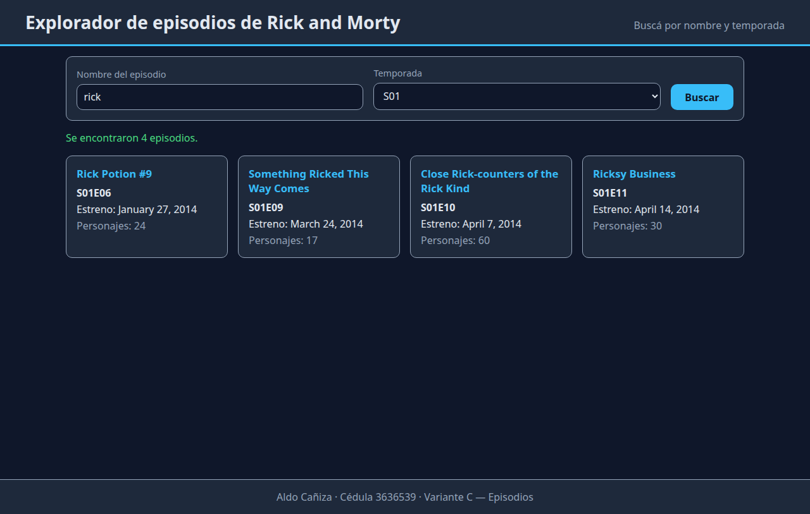

# Explorador de episodios de Rick and Morty

Página de una sola pantalla que busca episodios de la API pública de Rick and Morty combinando el nombre del episodio y la temporada en una sola petición. Resuelve la consulta de quien necesita ubicar un episodio concreto por nombre o por temporada sin recorrer toda la API.

**Autor:** Aldo Cañiza · Fundamentos de Desarrollo Web · UCSA
**Variante del TP:** C · Episodios (último dígito de cédula: 9)

## Sitios publicados

- GitHub Pages: https://aldocaniza.github.io/tp-caniza-aldo/
- Vercel: https://tp-caniza-aldo.vercel.app

## Captura



## Funcionalidades

- Búsqueda por nombre y por temporada (Todas, S01–S05) combinadas en la misma petición.
- Tarjetas con nombre, código del episodio, fecha de emisión y cantidad de personajes.
- Mensaje «Sin resultados» cuando la API devuelve 404 y mensaje de error si falla la conexión.
- Estado «Buscando...» con el botón deshabilitado durante la petición.
- Los últimos criterios quedan guardados en localStorage y se repiten al recargar.

## Tecnologías

- HTML5, CSS3, JavaScript (ES6+), Fetch API, localStorage, API de Rick and Morty.

## Estructura del proyecto

```
tp-caniza-aldo/
├── index.html        página (HTML semántico)
├── README.md         esta documentación
├── .gitignore        archivos que no se suben al repositorio
├── css/
│   └── estilos.css   estilos (variables, grid y flexbox)
├── js/
│   └── app.js        lógica de búsqueda, renderizado y estados
└── img/
    └── captura.png   captura usada en este README
```

## Cómo ejecutarlo localmente

1. `git clone https://github.com/aldocaniza/tp-caniza-aldo.git`
2. Abrir `index.html` en el navegador (o con Live Server).

## Despliegue

- GitHub Pages publica la rama `main` (Settings → Pages → Deploy from a branch).
- Cualquier `git push` a `main` vuelve a publicar las dos URL, por lo que el número de versión del pie se actualiza solo.
